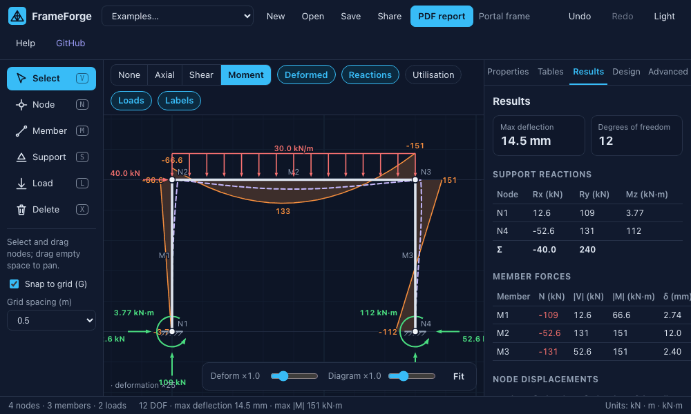
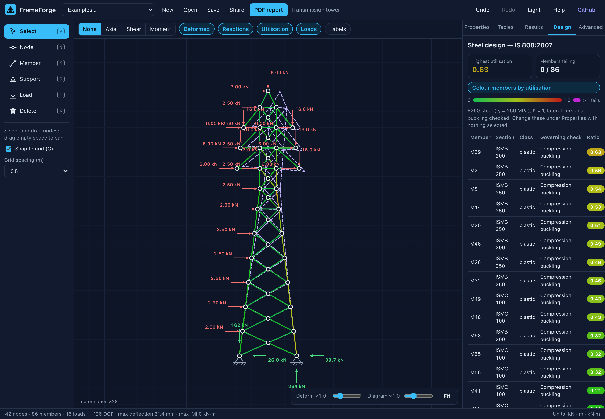
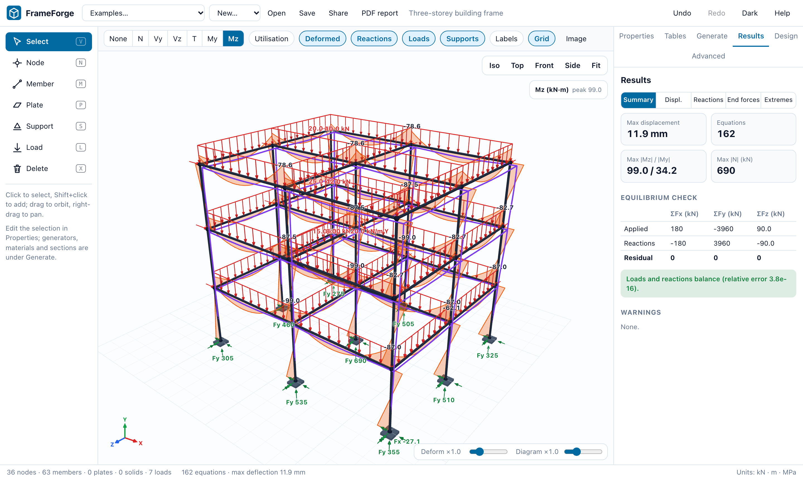
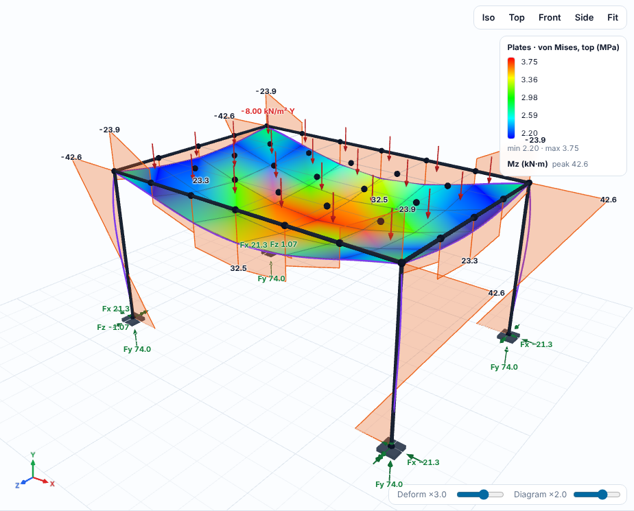
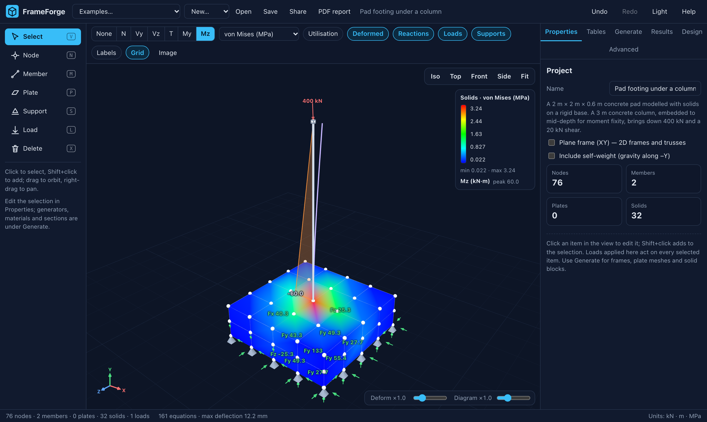
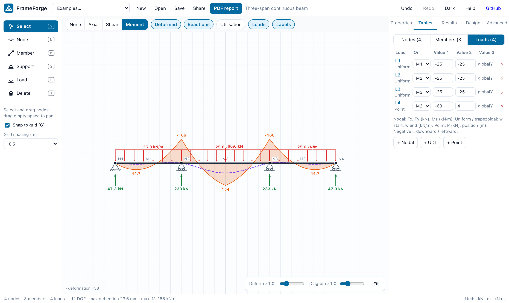
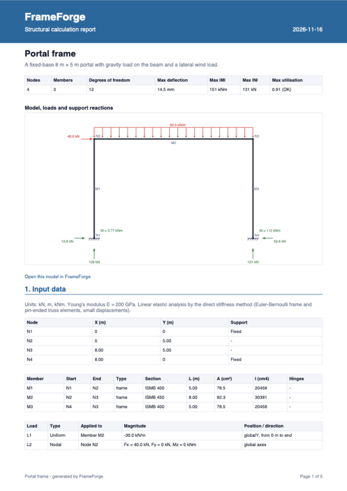
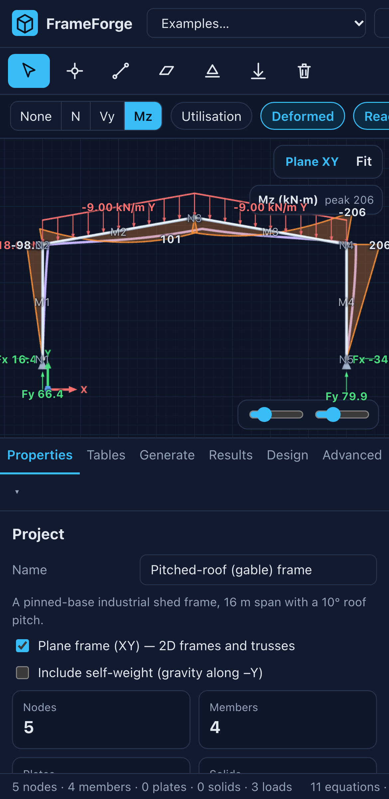
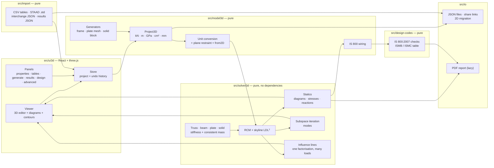

<div align="center">

# FrameForge

**A free, lightweight structural analysis tool that runs entirely in your browser.**

Model a space frame, a truss, a slab or a solid footing in 3D — or switch to plane-frame mode
for 2D beams, frames and trusses — and get deflections, reactions, force diagrams, IS 800:2007
steel checks, natural frequencies, influence lines and a PDF calculation report instantly.
No install, no licence, no backend.

### [▶ Open the live demo](https://wrucebayne29.github.io/frameforge/)

[](https://github.com/WruceBayne29/frameforge/actions/workflows/ci.yml)
[](https://github.com/WruceBayne29/frameforge/actions/workflows/deploy.yml)
[](LICENSE)




</div>

## Why

Commercial packages like STAAD.Pro and SAP2000 are powerful, expensive and heavy. As a civil
engineering student you mostly need to check a homework frame, see what a hinge does to a bending
moment diagram, or find out why your truss is a mechanism. FrameForge does exactly that, in a
browser tab, with a solver you can read.

The solver is written from scratch in TypeScript — the **direct stiffness method** for line
members and the finite element method for plates and solids, no FEM libraries — and is checked
against 26 textbook plane-frame problems to within 0.1 % and 27 more 3D problems: closed-form
answers for space trusses, space frames, vibration and influence lines, and published plate,
shell and elasticity benchmarks.

## Features

**Elements and loads**

- Truss (6 DOF), beam (12 DOF, Euler–Bernoulli, biaxial bending and torsion), 4-node flat-shell
  plate and 8-node solid elements, all in one model
- Any combination of the six restraints at a support; member end releases (hinges) for any of
  the six end forces
- Nodal forces and moments; uniform and trapezoidal loads over all or part of a member, point
  loads and point moments, in local or global axes; plate pressures and point loads; solid face
  loads; self-weight from the material densities

**Plane frames (2D)**

- A plane-frame mode for flat beams, frames and trusses: the model lies in the XY plane and only
  moves in it, the view locks to an orthographic front view, nodes snap to a grid on z = 0 and can
  be dragged with live re-analysis, and the tables show only the in-plane components
- Fixed, pinned and roller supports as in a 2D program; N, V and M diagrams
- Nine ready-made 2D structures (portal, gable and multi-storey frames, beams with hinges,
  Pratt and Warren trusses, a 32.5 m transmission tower)

**Results**

- Deflected shape and N, Vy, Vz, T, My, Mz diagrams with scale sliders; peaks located at points
  of zero shear; exact deflected shape along every member
- Contour plots of displacement, plate von Mises (top / bottom), Mx, My, Mxy and solid von
  Mises and principal stresses
- Reaction arrows; tables of displacements, reactions, member end forces and extremes, plate
  and solid stresses; an equilibrium check
- Unstable structures are caught and explained ("mechanism detected at node N4, translation
  along Y") instead of returning garbage

**Steel design — IS 800:2007**

- Built-in table of 25 rolled sections (ISMB 100–600, ISMC 75–400)
- Classification, tension, compression buckling about both axes, bending about both axes with
  lateral-torsional buckling, shear along the web and across the flanges (with the high-shear
  reduction), and the biaxial interaction checks of cl. 9.3.1.1 and 9.3.2.2
- One effective length factor per axis for the project, with per-member overrides
- Utilisation ratio as a colour on every member, with the full check breakdown per member

**Beyond statics**

- Modal analysis: natural frequencies, effective modal masses and animated 3D mode shapes from
  consistent mass matrices (beams with torsional inertia, trusses, plates, solids) plus lumped
  nodal masses, solved by subspace iteration on the sparse factorisation
- Influence lines for reactions, displacements and the six internal forces at any section, for a
  unit load moving along the beams — one factorisation, one solve per load position

**Editor and sharing**

- Three.js editor: orbit, pan, zoom, Iso / Top / Front / Side views; tools for nodes, members,
  plates, supports and loads; edit in a properties panel or by table; undo / redo
- Generators for a multi-storey building frame, a plate mesh on any four corners and a solid
  block
- PDF calculation report: inputs, results, vector diagrams in front, top and isometric
  projections, design checks and natural frequencies
- Save and open JSON, shareable links (the whole model is compressed into the URL, nothing is
  uploaded), PNG export; your last model is restored when you come back
- Files, links and saved models of the former 2D version of FrameForge open as plane frames
- Import models from other software: CSV tables (Excel), STAAD.Pro `.std` files, `?model=` URLs,
  a JavaScript / postMessage API and a command-line analyser (see below)
- Dark and light themes, responsive layout down to phone width, keyboard shortcuts

## Bring your own model

Models from other software come in through one validated format
([`docs/model.schema.json`](docs/model.schema.json)). Full details are in
[docs/IMPORT.md](docs/IMPORT.md).

- **Tables (CSV / Excel).** Click **Import** and paste or load tables of nodes (`id,x,y,z`),
  members (`id,i,j,section,type`), supports, nodal loads and member loads. Optional section
  and material tables are also accepted. Comma, tab and semicolon separators all work, header
  names are matched loosely, and you can choose m or mm and kN or N. Errors show the table and
  line number before anything is created.
- **STAAD.Pro.** Open a `.std` file. FrameForge reads joint and member generation with REPEAT,
  ISMB / ISMC tables, PRIS sections, constants, releases, supports, joint and member loads,
  self-weight, SET Z UP and a choice of load case. Anything it cannot use is listed as a
  warning.
- **By URL.** `?model=<https url to .json, .std or a CSV bundle>` opens a model on load, for
  example [a STAAD portal frame](https://wrucebayne29.github.io/frameforge/?model=samples/portal-frame.std).
- **JavaScript.** `window.frameforge.load / importCsv / importStd / analyze / getModel`, plus
  the same requests by `postMessage` from a page that embeds FrameForge in an iframe.
- **Headless.** `npx tsx scripts/analyze.ts model.std > results.json` runs the same solver in
  Node and prints displacements, reactions and member forces as JSON.

## Screenshots

| Design checks on a multi-storey plane frame | Transmission tower, coloured by utilisation |
| --- | --- |
|  |  |

| Three-storey 3D frame, Mz diagrams and reactions | Slab on beams: plate stress contours and beam moments |
| --- | --- |
|  |  |

| Animated mode shapes | Influence lines |
| --- | --- |
|  |  |

| Axial forces in a Pratt truss | 25-bar transmission tower, axial forces |
| --- | --- |
|  |  |

| Pad footing of 8-node solids (dark theme) | Edit by table |
| --- | --- |
|  |  |

| PDF calculation report | Phone layout |
| --- | --- |
|  |  |

## Elements

Global axes are right-handed with **Y up**; every node has six degrees of freedom
$[u_x, u_y, u_z, \theta_x, \theta_y, \theta_z]$.

| Element | Nodes | DOF | Formulation | Results |
| --- | --- | ---: | --- | --- |
| Truss | 2 | 6 | Axial bar, 3 translations per node | N, elongation |
| Beam | 2 | 12 | Euler–Bernoulli, axial + biaxial bending + St Venant torsion; roll angle β; any of the six end forces released at either end (static condensation) | N, Vy, Vz, T, My, Mz along the member, exact deflected shape |
| Plate | 4 | 24 | Flat shell: MITC4 Mindlin bending + QM6 incompatible-mode membrane + drilling penalty | Nx, Ny, Nxy, Mx, My, Mxy, Qx, Qy, top / bottom surface stresses, principal and von Mises |
| Solid | 8 | 24 | Hexahedron with Wilson–Taylor incompatible modes (modified, passes the patch test) | Stress tensor, principal and von Mises stresses at the centre and nodes |

In plane-frame mode every node is also held out of plane ($u_z = \theta_x = \theta_y = 0$), so
the same 3D solver gives exactly the 2D frame and truss results (checked to $10^{-8}$ against the
original 2D solver at every station of every example and textbook problem).

The equations are numbered in reverse Cuthill–McKee order and solved by a skyline (profile)
$LDL^T$ factorisation, so memory grows with the profile rather than $n^2$. A 30 × 30 plate mesh
(≈ 5,600 equations) solves in about half a second in the browser.

## Quick start

```bash
git clone https://github.com/WruceBayne29/frameforge.git
cd frameforge
npm install
npm run dev
```

| Command | What it does |
| --- | --- |
| `npm run dev` | Start the app with hot reload |
| `npm test` | Unit tests and both validation suites |
| `npm run coverage` | Tests with coverage (thresholds enforced on the solvers and the design code) |
| `npm run check` | Lint + tests + production build — run before every commit |
| `npm run validation` | Regenerate `VALIDATION.md` (plane-frame problems) |
| `npm run validation3d` | Regenerate `VALIDATION_3D.md` (3D problems) |
| `npm run e2e` | Playwright script that clicks through every feature (`node scripts/e2e3d.mjs <url>`) |
| `npm run --silent analyze -- <model>` | Analyse a `.json`, `.std` or CSV-bundle model from the command line; results JSON on stdout ([docs/IMPORT.md](docs/IMPORT.md)) |
| `npm run screenshots` | Regenerate the screenshots and GIF in this README (needs `npx vite preview --port 4179`) |

## How it works

The method is easiest to see on a plane frame, where each node can move in x, move in y and
rotate, so a structure with $n$ nodes has $3n$ degrees of freedom. (A plane frame in FrameForge
is a 3D model held in its plane; the 3D extension is summarised at the end of this section.) The direct stiffness method builds one
big system of equations

$$ K\,u = F $$

where $u$ holds every nodal displacement, $F$ every nodal load, and $K$ is the **global stiffness
matrix**, assembled from the small stiffness matrix of each member.

**1. Element stiffness.** In its own (local) axes, a frame member of length $L$ with axial
stiffness $EA$ and bending stiffness $EI$ relates its six end displacements to its six end forces
through

$$
k_l =
\begin{bmatrix}
\frac{EA}{L} & 0 & 0 & -\frac{EA}{L} & 0 & 0 \\
0 & \frac{12EI}{L^3} & \frac{6EI}{L^2} & 0 & -\frac{12EI}{L^3} & \frac{6EI}{L^2} \\
0 & \frac{6EI}{L^2} & \frac{4EI}{L} & 0 & -\frac{6EI}{L^2} & \frac{2EI}{L} \\
-\frac{EA}{L} & 0 & 0 & \frac{EA}{L} & 0 & 0 \\
0 & -\frac{12EI}{L^3} & -\frac{6EI}{L^2} & 0 & \frac{12EI}{L^3} & -\frac{6EI}{L^2} \\
0 & \frac{6EI}{L^2} & \frac{2EI}{L} & 0 & -\frac{6EI}{L^2} & \frac{4EI}{L}
\end{bmatrix}
$$

A truss member keeps only the $EA/L$ terms.

**2. Rotate to global axes.** For a member inclined at $\theta$, with $c = \cos\theta$ and
$s = \sin\theta$,

$$
k_g = T^{T} k_l\, T, \qquad
T = \begin{bmatrix} R & 0 \\ 0 & R \end{bmatrix}, \qquad
R = \begin{bmatrix} c & s & 0 \\ -s & c & 0 \\ 0 & 0 & 1 \end{bmatrix}
$$

**3. Assemble and apply supports.** Each $k_g$ is added into $K$ at the rows and columns of its
two nodes. Splitting the degrees of freedom into free ($f$) and restrained ($r$) gives

$$ K_{ff}\,u_f = F_f - K_{fr}\,u_r, \qquad R = K_{rf}\,u_f + K_{rr}\,u_r - F_r $$

$K_{ff}$ is symmetric positive definite for a stable structure, so it is solved by Cholesky
factorisation. A zero pivot means a mechanism, and its position says which node is free to move.

**4. Member loads.** A distributed load $w(x)$ is replaced by work-equivalent nodal loads using
the member's shape functions $N(x)$:

$$ f_{eq} = \int_0^L N^{T}(x)\,w(x)\,dx $$

For a uniform load this gives the familiar $wL/2$ and $wL^2/12$. The integral is evaluated with
Gauss quadrature, which is exact for the partial and trapezoidal loads FrameForge supports.

**5. Hinges.** A moment release is handled by statically condensing the released rotation out of
the element matrices, which turns the $4EI/L$ terms into $3EI/L$:

$$ k^{\ast} = k_{kk} - k_{kr}\,k_{rr}^{-1}\,k_{rk} $$

**6. Recover the diagrams.** Member end forces are $f = k_l\,u_l - f_{eq}$. From those, $N(x)$,
$V(x)$ and $M(x)$ follow from statics, and the deflected shape from integrating
$EI\,v'' = M$ twice.

The full derivation — shape functions, the stiffness integral, a worked example, the IS 800
formulas — is in **[docs/THEORY.md](docs/THEORY.md)**.

**In 3D** — the solver the app runs for everything — the same steps apply with six DOFs per node: a 12 × 12 beam matrix rotated by a 3 × 3
direction-cosine block, a 24 × 24 flat-shell matrix and a 24 × 24 hexahedron matrix, assembled
into a sparse matrix and solved by a skyline $LDL^T$ factorisation. The derivations are in
**[docs/THEORY_3D.md](docs/THEORY_3D.md)**.

## Validation

Every solver change is checked against closed-form answers and published benchmarks. The tables
below are generated by the test suites themselves (`npm run validation`, `npm run validation3d`);
the complete results, quantity by quantity, are in **[VALIDATION.md](VALIDATION.md)** and
**[VALIDATION_3D.md](VALIDATION_3D.md)**.

### Plane frames

The 2D textbook problems run through the solver the app uses: each is converted to a plane-frame
3D model and solved by the 3D solver (statics, modal analysis and influence lines). The original
2D solver stays in the repository as a reference; both must pass, and the two must agree to
$10^{-8}$.

<!-- validation:start -->
**26 problems, 122 quantities, all within 0.1 %.**

| # | Problem | Closed-form checks | Quantities | Max error |
| --- | --- | --- | ---: | ---: |
| V01 | Cantilever with a point load at the tip | PL³/3EI, PL²/2EI, PL (hogging), … | 5 | < 0.0001 % |
| V02 | Cantilever with a uniformly distributed load | wL⁴/8EI, wL³/6EI, wL²/2 (hogging), … | 5 | < 0.0001 % |
| V03 | Simply supported beam with a central point load | PL³/48EI, PL/4, PL²/16EI, … | 5 | < 0.0001 % |
| V04 | Simply supported beam with a UDL (single element) | 5wL⁴/384EI, wL²/8, wL³/24EI, … | 5 | < 0.0001 % |
| V05 | Simply supported beam with an off-centre point load (member load) | Pb/L, Pa/L, Pab/L, … | 5 | < 0.0001 % |
| V06 | Propped cantilever with a UDL | 3wL/8, 5wL/8, wL²/8 (hogging), … | 6 | < 0.0001 % |
| V07 | Fixed-fixed beam with a UDL | wL²/12 (hogging), wL²/24, wL⁴/384EI, … | 4 | < 0.0001 % |
| V08 | Fixed-fixed beam with a central point load | PL/8 (hogging), PL/8, PL³/192EI | 3 | < 0.0001 % |
| V09 | Two-span continuous beam, equal spans, UDL | 3wL/8, 10wL/8, wL²/8 (hogging), … | 5 | < 0.0001 % |
| V10 | Three-span continuous beam, equal spans, UDL | 0.4wL, 1.1wL, 0.1wL² (hogging), … | 5 | < 0.0001 % |
| V11 | Fixed-base portal frame with a lateral load | Ph(3k+1)/[2(6k+1)], 3Phk/[2(6k+1)], P/2, … | 5 | < 0.0001 % |
| V12 | Pinned-base portal frame with a UDL on the beam | wL²/[4h(2k+3)], H·h (hogging), wL²/8 − H·h, … | 4 | < 0.0001 % |
| V13 | Pratt truss, 4 panels, loads at the bottom-chord joints | −1.5P/sinθ, 1.5Pa/h, −2Pa/h, … | 7 | < 0.0001 % |
| V14 | Warren truss (equilateral), loads at the bottom-chord joints | −2P/√3, 2P/√3, 0 (zero shear panel), … | 7 | < 0.0001 % |
| V15 | Symmetric two-bar truss | −P/(2 sinθ), PL/(2EA sin²θ), P/(2 tanθ) | 3 | < 0.0001 % |
| V16 | Compound beam with an internal hinge (member end release) | wL₂/2, 0, (wL₂/2)·L₁ (hogging), … | 5 | < 0.0001 % |
| V17 | Fixed-fixed beam with a support settlement | 6EIΔ/L², 12EIΔ/L³, 6EIΔ/L² | 3 | < 0.0001 % |
| V18 | Simply supported beam with a triangular load | wL/6, wL/3, wL²/(9√3), … | 5 | < 0.0001 % |
| V19 | Fixed-fixed beam with a triangular load | wL²/30, wL²/20, 3wL/20, … | 4 | < 0.0001 % |
| V20 | Simply supported beam with a counter-clockwise moment at midspan | M₀/L, −M₀/L, M₀/2, … | 5 | < 0.0001 % |
| V21 | Inclined simply supported rafter under gravity load | wL/2, w·L·L_h/8, −(wL/2)·sinα, … | 4 | < 0.0001 % |
| V22 | Cantilever propped by a spring | P/(k_s + 3EI/L³), P·k_s/(k_s + 3EI/L³), (P − F_s)·L (hogging) | 3 | < 0.0001 % |
| V23 | Natural frequencies of a simply supported beam (modal analysis) | π²·√(EI/mL⁴), 4π²·√(EI/mL⁴), 9π²·√(EI/mL⁴), … | 4 | 0.0260 % |
| V24 | Natural frequencies of a cantilever (modal analysis) | 1.8751²·√(EI/mL⁴), 4.6941²·√(EI/mL⁴), 2π/ω₁ | 3 | 0.0016 % |
| V25 | Influence lines for a simply supported beam | 1 − x/L, 1 − x/L, L/4, … | 6 | < 0.0001 % |
| V26 | Influence line for the central reaction of a two-span continuous beam | x(3L² − x²)/2L³, x(3L² − x²)/2L³, x(3L² − x²)/2L³, … | 6 | < 0.0001 % |
<!-- validation:end -->

### 3D

Line elements are exact for the loads they carry, so truss and beam cases must match to 0.1 %.
Plate and solid cases compare a finite-element mesh with a continuum solution; each states the
tolerance its mesh is expected to meet, and the table shows the error actually reached.

<!-- validation3d:start -->
**27 problems, 125 quantities, each within its stated tolerance.**

| # | Problem | Quantities | Tolerance | Max error |
| --- | --- | ---: | ---: | ---: |
| T01 | Tripod (statically determinate space truss) under a general apex load | 7 | 0.1 % | < 0.0001 % |
| T02 | Square pyramid (one redundant bar) under vertical and horizontal apex loads | 5 | 0.1 % | < 0.0001 % |
| B01 | L-shaped cantilever (grillage) with an out-of-plane tip load: bending + torsion | 8 | 0.1 % | < 0.0001 % |
| B02 | Skew cantilever, roll angle β = 30°, with a biaxial tip load | 8 | 0.1 % | < 0.0001 % |
| B03 | Fixed-fixed beam along Z: UDL in the local x–y plane, point load in the local x–z plane | 8 | 0.1 % | < 0.0001 % |
| B04 | Four-column table frame swaying in X and Z (weak and strong column axes) | 6 | 0.1 % | < 0.0001 % |
| B05 | Secondary beam with moment releases at both ends, framing into two fixed girders | 7 | 0.1 % | < 0.0001 % |
| B06 | Simply supported beam on a skew plan line (30° to X) with vertical and lateral UDLs | 7 | 0.1 % | < 0.0001 % |
| B07 | Space frame with every member load type: reactions balance the loads (6 components) | 6 | 0.1 % | < 0.0001 % |
| P01 | Simply supported square plate, uniform pressure (a/t = 100, 16 × 16 mesh) | 4 | 1 % | 0.0746 % |
| P02 | Simply supported square plate, central point load (16 × 16 mesh) | 2 | 1 % | 0.3519 % |
| P03 | Clamped square plate, uniform pressure (a/t = 100, 16 × 16 mesh) | 2 | 2 % | 0.4280 % |
| P04 | Cantilever plate strip (ν = 0) with a tip line load, 10 elements | 4 | 0.5 % | 0.2500 % |
| P05 | Square plate twisted by corner forces (pure Mxy), a/t = 100, 4 × 4 mesh | 2 | 0.5 % | 0.0705 % |
| P06 | Scordelis–Lo barrel vault under self-weight (quarter model, 16 × 16 mesh) | 1 | 1 % | 0.0005 % |
| P07 | Square box-section cantilever of folded plates (20 × 8 mesh), end torque | 4 | 0.5 % | 0.1558 % |
| H01 | Prismatic bar in uniaxial tension (4 × 1 × 1 hexahedra) | 6 | 0.1 % | < 0.0001 % |
| H02 | Slender solid cantilever (L/h = 10) with an end shear, 20 × 2 × 2 hexahedra | 3 | 1 % | 0.1524 % |
| H03 | Constant-strain patch test on a distorted 3 × 3 × 3 mesh of a unit cube | 9 | 0.1 % | < 0.0001 % |
| H04 | Solid column under its own weight (ν = 0, 2 × 6 × 2 hexahedra) | 4 | 0.1 % | < 0.0001 % |
| M01 | Natural frequencies of a simply supported beam, bending about both axes (16 elements) | 4 | 0.1 % | 0.0016 % |
| M02 | Cantilever: first two bending frequencies and effective modal mass (12 elements) | 3 | 0.1 % | 0.0378 % |
| M03 | Fixed–free shaft: torsional and axial frequencies (20 elements) | 3 | 0.3 % | 0.2315 % |
| M04 | Simply supported square plate, first two frequencies (a/t = 100, 16 × 16 mesh) | 2 | 2 % | 1.4340 % |
| M05 | Solid cantilever (ν = 0, L/h = 20, 20 × 2 × 2 hexahedra): bending and axial frequencies | 2 | 1.5 % | 0.1141 % |
| I01 | Influence lines of a two-span continuous beam along Z: central reaction and support moment | 4 | 0.1 % | < 0.0001 % |
| I02 | L-shaped grillage: torque and bending at the root as a load moves along the arm | 4 | 0.1 % | < 0.0001 % |
<!-- validation3d:end -->

## Architecture

The solver knows nothing about React, the browser or units. The UI knows nothing about matrices.



```
src/
  solver3d/       truss, beam, plate and solid elements; sparse skyline solver; statics, modal
                  analysis (consistent mass, subspace iteration), influence lines
  design-codes/   IS 800:2007 member checks (uniaxial and biaxial) and the rolled-section table
  model3d/        the project model, units, generators, plane-frame mode, design wiring, from2D
  examples3d/     nine 3D examples, plus the nine 2D examples converted to plane frames
  io/             JSON files, share links, migration of old 2D files and links, PDF report
  import/         CSV tables and bundles, STAAD.Pro .std reader, interchange JSON, results JSON
  ui3d/           React components and the three.js viewer
  solver/, model/, examples/
                  the original 2D solver and project model: kept to read old 2D files and as the
                  reference the plane-frame mode is tested against
tests/validation/ 26 plane-frame problems, 27 3D problems, plane-mode equivalence tests
scripts/          Playwright end-to-end script, screenshot generator, analyze.ts (headless CLI)
docs/             THEORY.md (plane frames, IS 800), THEORY_3D.md (3D elements, mass, eigen
                  solver, influence lines), IMPORT.md and model.schema.json, screenshots
public/samples/   sample models to import (STAAD, CSV bundle, JSON)
```

Engineering rules the code holds itself to: strict TypeScript with no `any`, ESLint and Prettier
clean, coverage thresholds enforced in CI, and lint + tests + build run before every commit.

## Keyboard shortcuts

| Key | Action | Key | Action |
| --- | --- | --- | --- |
| `V` | Select (Shift+click adds; drag a node in plane mode) | `1` … `6` | N, Vy, Vz, T, My, Mz diagram |
| `N` | Add node | `0` | Hide diagrams |
| `M` | Draw member | `C` | Next contour plot |
| `P` | Draw plate | `D` | Toggle deflected shape |
| `S` | Support tool | `R` | Toggle reactions |
| `L` | Load tool | `U` | Toggle utilisation colours |
| `X` | Delete tool | `F` | Fit to window |
| `Del` | Delete selection | `G` | Toggle snap |
| `Ctrl+Z` / `Ctrl+Shift+Z` | Undo / redo | `?` | Help |

## Limitations

- Linear elastic, small displacements; no P-Δ, buckling analysis, cracking or yielding.
- One load case; no load combinations — enter factored loads directly. STAAD imports bring in
  one load case at a time; plates, offsets, springs and floor loads in a `.std` file are skipped
  with a warning.
- The IS 800 check uses the largest values along each member (not the concurrent values at one
  section), the analysis loads as design loads, and the simplified linear section interaction.
  Torsion is not checked. Members with custom sections are skipped.
- The torsion constant of rolled ISMB / ISMC sections comes from $\sum b t^3 / 3$ (fillets
  ignored), slightly below handbook values; the minor-axis plastic modulus is computed from the
  idealised section.
- Modal analysis uses consistent mass without the rotary inertia of bending; influence lines use
  a unit load moving along members (not over plates).
- A warped quadrilateral plate is analysed on its projection onto the mean plane (with a
  warning); plate loads produce nodal forces only.
- Plate and solid stresses are element values at the nodes, not averaged between elements
  (contour plots average them for display).
- Solids can only be created with the block generator; there is no drawing tool for them.
- The solve runs on the main thread: about 0.5 s for ≈ 5,600 equations.

It is a learning tool. Do not use it as the sole basis for a real design.

## Roadmap

- [x] Direct stiffness solver with validation suite
- [x] Interactive editor, results view, IS 800 checks
- [x] PDF, JSON and share-link export
- [x] Modal analysis and influence lines
- [x] 3D space frames, space trusses, plates and solids
- [x] One 3D app with a plane-frame mode; biaxial IS 800 checks, 3D modal analysis, influence
      lines and PDF report
- [ ] Load cases and combinations with IS 875 / IS 800 load factors
- [ ] Angle and hollow sections; built-up members
- [ ] Settlements and spring supports in the editor (the solver supports them)
- [ ] Second-order (P-Δ) analysis and linear buckling
- [ ] Solving in a Web Worker for very large meshes
- [ ] IS 456 reinforced concrete beam checks

## Contributing

Bug reports and pull requests are welcome — see [CONTRIBUTING.md](CONTRIBUTING.md). If the solver
gives you a wrong answer, please open a "wrong result" issue with the share link and the expected
value; that is the most useful kind of bug report there is.

## License

[MIT](LICENSE)
