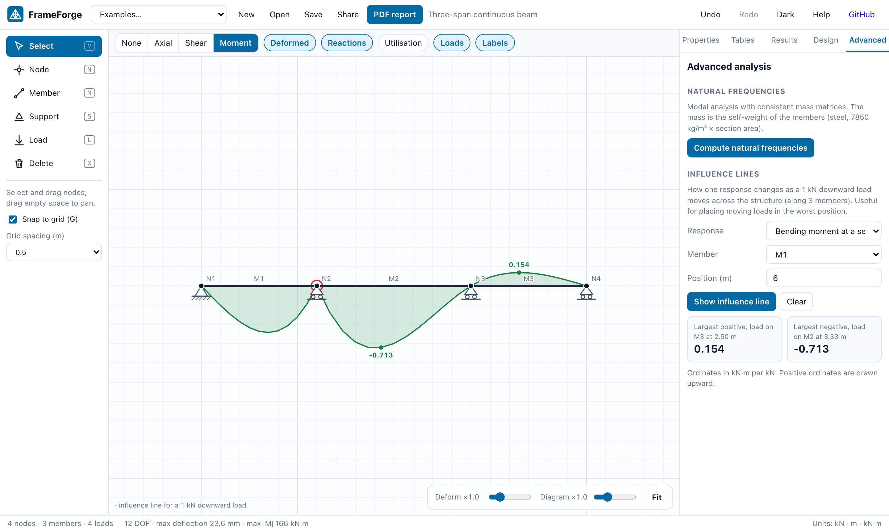
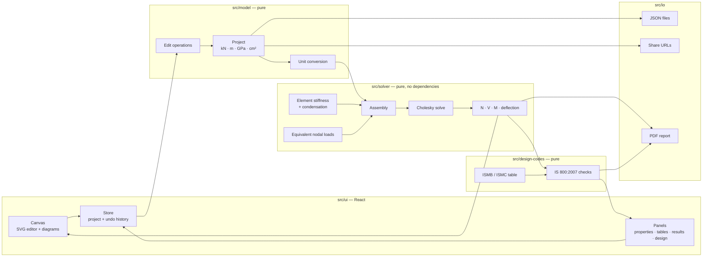

<div align="center">

# FrameForge

**A free, lightweight structural analysis tool that runs entirely in your browser.**

Draw a truss, beam or frame, and get deflections, reactions, force diagrams and
IS 800:2007 steel checks instantly — no install, no licence, no backend.

### [▶ Open the live demo](https://wrucebayne29.github.io/frameforge/)

[](https://github.com/WruceBayne29/frameforge/actions/workflows/ci.yml)
[](https://github.com/WruceBayne29/frameforge/actions/workflows/deploy.yml)
[](LICENSE)


</div>

## Why

Commercial packages like STAAD.Pro and SAP2000 are powerful, expensive and heavy. As a civil
engineering student you mostly need to check a homework frame, see what a hinge does to a bending
moment diagram, or find out why your truss is a mechanism. FrameForge does exactly that, in a
browser tab, with a solver you can read.

The solver is written from scratch in TypeScript using the **direct stiffness method** — no FEM
libraries — and is checked against 26 textbook problems to within 0.1 %.

## Features

**Analysis**

- 2D frame (axial + shear + bending) and pin-ended truss elements
- Fixed, pinned and roller supports; member end releases (internal hinges)
- Point loads, moments, uniform and trapezoidal loads over all or part of a member, in local or
  global axes
- Nodal displacements, support reactions, member end forces
- Exact axial force, shear force and bending moment diagrams, with maxima located at points of
  zero shear, and the exact deflected shape along every member
- Unstable structures are caught and explained ("mechanism detected at node N4, vertical
  translation") instead of returning garbage

**Editor**

- Click to add nodes, members, supports and loads, with snap-to-grid
- Click a member to split it — its loads are carried over to both halves
- Drag a node and watch the results update live
- Undo / redo for everything, including loading a new model
- Edit-by-table for nodes, members and loads as an alternative to drawing

**Results**

- Deflected shape and diagrams with scale sliders
- Reaction arrows with values
- Hover anywhere on a member for N, V, M and deflection at that point
- Results, displacement and member force tables

**Steel design — IS 800:2007**

- Built-in table of 25 rolled sections (ISMB 100–600, ISMC 75–400)
- Section classification, tension, compression buckling, bending with lateral-torsional
  buckling, shear and combined axial + bending interaction
- Utilisation ratio shown as a colour on every member, with the full check breakdown per member

**Beyond statics**

- Modal analysis: natural frequencies and animated mode shapes from consistent mass matrices
- Influence lines for reactions, shear, bending moment and deflection under a moving unit load

**Sharing**

- PDF calculation report: inputs, results, diagrams and design checks, drawn as vectors
- Save and open models as JSON
- Shareable links — the whole model is compressed into the URL, nothing is uploaded
- Your last model is restored when you come back

**Polish**

- Dark and light themes, responsive layout down to phone width
- Keyboard shortcuts for every tool and view
- First-run walkthrough
- Nine example structures, including a 32.5 m transmission tower

## Screenshots

| Design checks on a multi-storey frame | Transmission tower, coloured by utilisation |
| --- | --- |
|  |  |

| Axial forces in a Pratt truss | Edit by table |
| --- | --- |
|  |  |

| Animated mode shapes | Influence lines |
| --- | --- |
|  |  |

| PDF calculation report | Phone layout |
| --- | --- |
|  |  |

## Quick start

```bash
git clone https://github.com/WruceBayne29/frameforge.git
cd frameforge
npm install
npm run dev
```

| Command | What it does |
| --- | --- |
| `npm run dev` | Start the app with hot reload |
| `npm test` | Unit tests and the validation suite |
| `npm run coverage` | Tests with coverage (thresholds enforced on the solver) |
| `npm run check` | Lint + tests + production build — run before every commit |
| `npm run validation` | Regenerate `VALIDATION.md` from the test suite |
| `npm run e2e` | Playwright script that clicks through every feature on the live site |
| `npm run screenshots` | Regenerate the screenshots and GIF in this README |

## How it works

A structure is a set of members joined at nodes. Each node can move in x, move in y and rotate,
so a structure with $n$ nodes has $3n$ degrees of freedom. The direct stiffness method builds one
big system of equations

$$ K\,u = F $$

where $u$ holds every nodal displacement, $F$ every nodal load, and $K$ is the **global stiffness
matrix**, assembled from the small stiffness matrix of each member.

**1. Element stiffness.** In its own (local) axes, a frame member of length $L$ with axial
stiffness $EA$ and bending stiffness $EI$ relates its six end displacements to its six end forces
through

$$
k_l =
\begin{bmatrix}
\frac{EA}{L} & 0 & 0 & -\frac{EA}{L} & 0 & 0 \\
0 & \frac{12EI}{L^3} & \frac{6EI}{L^2} & 0 & -\frac{12EI}{L^3} & \frac{6EI}{L^2} \\
0 & \frac{6EI}{L^2} & \frac{4EI}{L} & 0 & -\frac{6EI}{L^2} & \frac{2EI}{L} \\
-\frac{EA}{L} & 0 & 0 & \frac{EA}{L} & 0 & 0 \\
0 & -\frac{12EI}{L^3} & -\frac{6EI}{L^2} & 0 & \frac{12EI}{L^3} & -\frac{6EI}{L^2} \\
0 & \frac{6EI}{L^2} & \frac{2EI}{L} & 0 & -\frac{6EI}{L^2} & \frac{4EI}{L}
\end{bmatrix}
$$

A truss member keeps only the $EA/L$ terms.

**2. Rotate to global axes.** For a member inclined at $\theta$, with $c = \cos\theta$ and
$s = \sin\theta$,

$$
k_g = T^{T} k_l\, T, \qquad
T = \begin{bmatrix} R & 0 \\ 0 & R \end{bmatrix}, \qquad
R = \begin{bmatrix} c & s & 0 \\ -s & c & 0 \\ 0 & 0 & 1 \end{bmatrix}
$$

**3. Assemble and apply supports.** Each $k_g$ is added into $K$ at the rows and columns of its
two nodes. Splitting the degrees of freedom into free ($f$) and restrained ($r$) gives

$$ K_{ff}\,u_f = F_f - K_{fr}\,u_r, \qquad R = K_{rf}\,u_f + K_{rr}\,u_r - F_r $$

$K_{ff}$ is symmetric positive definite for a stable structure, so it is solved by Cholesky
factorisation. A zero pivot means a mechanism, and its position says which node is free to move.

**4. Member loads.** A distributed load $w(x)$ is replaced by work-equivalent nodal loads using
the member's shape functions $N(x)$:

$$ f_{eq} = \int_0^L N^{T}(x)\,w(x)\,dx $$

For a uniform load this gives the familiar $wL/2$ and $wL^2/12$. The integral is evaluated with
Gauss quadrature, which is exact for the partial and trapezoidal loads FrameForge supports.

**5. Hinges.** A moment release is handled by statically condensing the released rotation out of
the element matrices, which turns the $4EI/L$ terms into $3EI/L$:

$$ k^{\ast} = k_{kk} - k_{kr}\,k_{rr}^{-1}\,k_{rk} $$

**6. Recover the diagrams.** Member end forces are $f = k_l\,u_l - f_{eq}$. From those, $N(x)$,
$V(x)$ and $M(x)$ follow from statics, and the deflected shape from integrating
$EI\,v'' = M$ twice.

The full derivation — shape functions, the stiffness integral, a worked example, the IS 800
formulas — is in **[docs/THEORY.md](docs/THEORY.md)**.

## Validation

Every solver change is checked against closed-form textbook answers. The table below is generated
by the test suite itself (`npm run validation`); the complete results, quantity by quantity, are
in **[VALIDATION.md](VALIDATION.md)**.

<!-- validation:start -->
**26 problems, 122 quantities, all within 0.1 %.**

| # | Problem | Closed-form checks | Quantities | Max error |
| --- | --- | --- | ---: | ---: |
| V01 | Cantilever with a point load at the tip | PL³/3EI, PL²/2EI, PL (hogging), … | 5 | < 0.0001 % |
| V02 | Cantilever with a uniformly distributed load | wL⁴/8EI, wL³/6EI, wL²/2 (hogging), … | 5 | < 0.0001 % |
| V03 | Simply supported beam with a central point load | PL³/48EI, PL/4, PL²/16EI, … | 5 | < 0.0001 % |
| V04 | Simply supported beam with a UDL (single element) | 5wL⁴/384EI, wL²/8, wL³/24EI, … | 5 | < 0.0001 % |
| V05 | Simply supported beam with an off-centre point load (member load) | Pb/L, Pa/L, Pab/L, … | 5 | < 0.0001 % |
| V06 | Propped cantilever with a UDL | 3wL/8, 5wL/8, wL²/8 (hogging), … | 6 | < 0.0001 % |
| V07 | Fixed-fixed beam with a UDL | wL²/12 (hogging), wL²/24, wL⁴/384EI, … | 4 | < 0.0001 % |
| V08 | Fixed-fixed beam with a central point load | PL/8 (hogging), PL/8, PL³/192EI | 3 | < 0.0001 % |
| V09 | Two-span continuous beam, equal spans, UDL | 3wL/8, 10wL/8, wL²/8 (hogging), … | 5 | < 0.0001 % |
| V10 | Three-span continuous beam, equal spans, UDL | 0.4wL, 1.1wL, 0.1wL² (hogging), … | 5 | < 0.0001 % |
| V11 | Fixed-base portal frame with a lateral load | Ph(3k+1)/[2(6k+1)], 3Phk/[2(6k+1)], P/2, … | 5 | < 0.0001 % |
| V12 | Pinned-base portal frame with a UDL on the beam | wL²/[4h(2k+3)], H·h (hogging), wL²/8 − H·h, … | 4 | < 0.0001 % |
| V13 | Pratt truss, 4 panels, loads at the bottom-chord joints | −1.5P/sinθ, 1.5Pa/h, −2Pa/h, … | 7 | < 0.0001 % |
| V14 | Warren truss (equilateral), loads at the bottom-chord joints | −2P/√3, 2P/√3, 0 (zero shear panel), … | 7 | < 0.0001 % |
| V15 | Symmetric two-bar truss | −P/(2 sinθ), PL/(2EA sin²θ), P/(2 tanθ) | 3 | < 0.0001 % |
| V16 | Compound beam with an internal hinge (member end release) | wL₂/2, 0, (wL₂/2)·L₁ (hogging), … | 5 | < 0.0001 % |
| V17 | Fixed-fixed beam with a support settlement | 6EIΔ/L², 12EIΔ/L³, 6EIΔ/L² | 3 | < 0.0001 % |
| V18 | Simply supported beam with a triangular load | wL/6, wL/3, wL²/(9√3), … | 5 | < 0.0001 % |
| V19 | Fixed-fixed beam with a triangular load | wL²/30, wL²/20, 3wL/20, … | 4 | < 0.0001 % |
| V20 | Simply supported beam with a counter-clockwise moment at midspan | M₀/L, −M₀/L, M₀/2, … | 5 | < 0.0001 % |
| V21 | Inclined simply supported rafter under gravity load | wL/2, w·L·L_h/8, −(wL/2)·sinα, … | 4 | < 0.0001 % |
| V22 | Cantilever propped by a spring | P/(k_s + 3EI/L³), P·k_s/(k_s + 3EI/L³), (P − F_s)·L (hogging) | 3 | < 0.0001 % |
| V23 | Natural frequencies of a simply supported beam (modal analysis) | π²·√(EI/mL⁴), 4π²·√(EI/mL⁴), 9π²·√(EI/mL⁴), … | 4 | 0.0260 % |
| V24 | Natural frequencies of a cantilever (modal analysis) | 1.8751²·√(EI/mL⁴), 4.6941²·√(EI/mL⁴), 2π/ω₁ | 3 | 0.0016 % |
| V25 | Influence lines for a simply supported beam | 1 − x/L, 1 − x/L, L/4, … | 6 | < 0.0001 % |
| V26 | Influence line for the central reaction of a two-span continuous beam | x(3L² − x²)/2L³, x(3L² − x²)/2L³, x(3L² − x²)/2L³, … | 6 | < 0.0001 % |
<!-- validation:end -->

## Architecture

The solver knows nothing about React, the browser or units. The UI knows nothing about matrices.



```
src/
  solver/         direct stiffness method, modal analysis, influence lines — 99 % coverage
  design-codes/   IS 800:2007 member checks and the rolled-section table
  model/          the project model, unit conversion and pure editing operations
  examples/       nine ready-made structures
  io/             JSON files, share links, PDF report
  ui/             React components: canvas, toolbar, panels
tests/validation/ 26 textbook problems with closed-form answers
scripts/          Playwright end-to-end script and screenshot generator
docs/             THEORY.md and screenshots
```

Engineering rules the code holds itself to: strict TypeScript with no `any`, ESLint and Prettier
clean, coverage thresholds enforced in CI, and lint + tests + build run before every commit.

## Keyboard shortcuts

| Key | Action | Key | Action |
| --- | --- | --- | --- |
| `V` | Select / move | `1` `2` `3` | Axial / shear / moment diagram |
| `N` | Add node | `0` | Hide diagrams |
| `M` | Draw member | `D` | Toggle deflected shape |
| `S` | Add support | `R` | Toggle reactions |
| `L` | Add load | `U` | Toggle utilisation colours |
| `X` | Delete tool | `F` | Fit to window |
| `Del` | Delete selection | `G` | Toggle snap |
| `Ctrl+Z` / `Ctrl+Shift+Z` | Undo / redo | `?` | Help |

## Assumptions and limits

FrameForge does linear elastic, small-displacement analysis of plane structures. Modal analysis
uses the members' self-weight as the only mass. It does not model
shear deformation, P-Δ effects, material yielding or out-of-plane behaviour. The design module
checks rolled ISMB and ISMC members for axial force and major-axis bending, uses the analysis loads
as design loads, and applies one steel grade and effective length factor to the whole model.

It is a learning tool. Do not use it as the sole basis for a real design.

## Roadmap

- [x] Direct stiffness solver with validation suite
- [x] Interactive editor, results view, IS 800 checks
- [x] PDF, JSON and share-link export
- [x] Modal analysis (natural frequencies, mode shapes)
- [x] Influence lines for moving loads
- [ ] Load cases and combinations with IS 875 / IS 800 load factors
- [ ] Angle and hollow sections; built-up members
- [ ] Self-weight and temperature loads
- [ ] Inclined supports
- [ ] Second-order (P-Δ) analysis
- [ ] 3D space frames
- [ ] IS 456 reinforced concrete beam checks

## Contributing

Bug reports and pull requests are welcome — see [CONTRIBUTING.md](CONTRIBUTING.md). If the solver
gives you a wrong answer, please open a "wrong result" issue with the share link and the expected
value; that is the most useful kind of bug report there is.

## License

[MIT](LICENSE)
