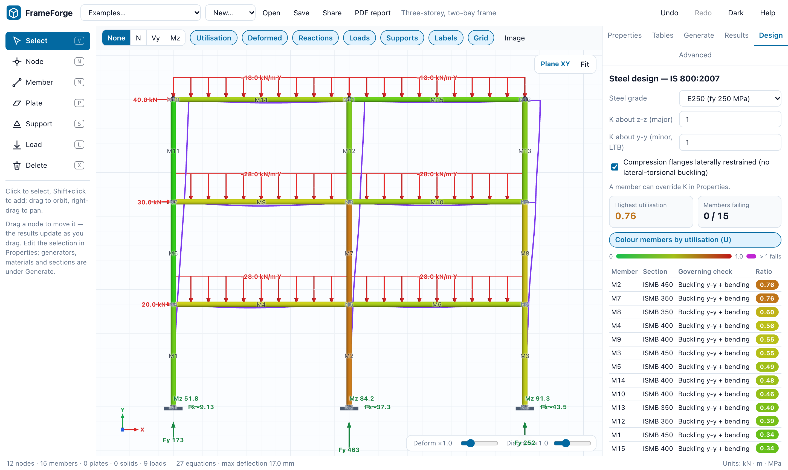
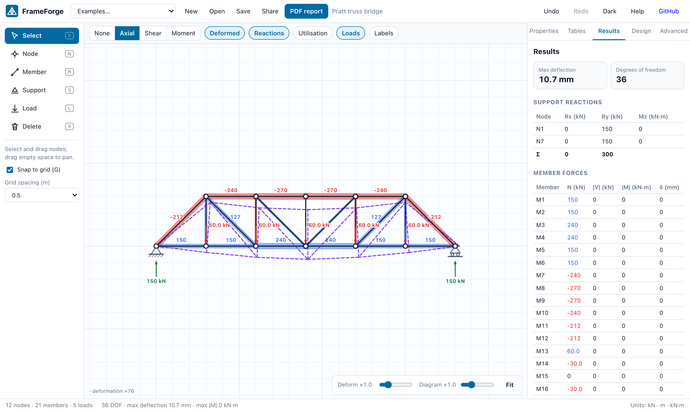
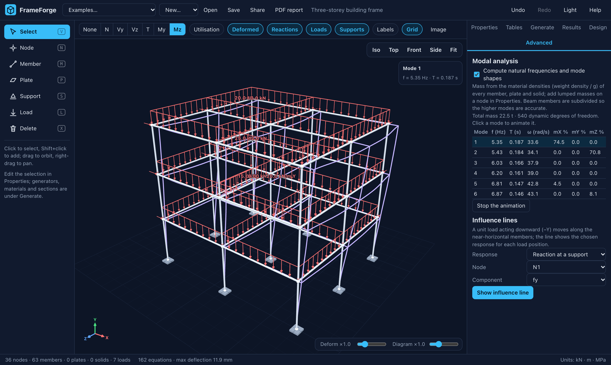
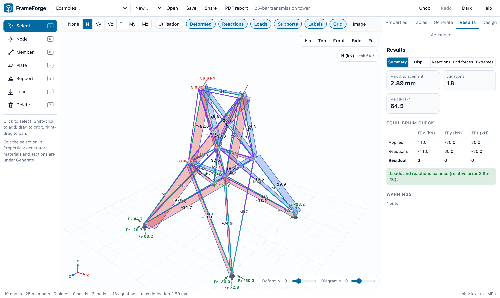
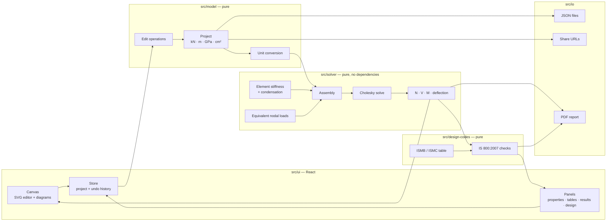
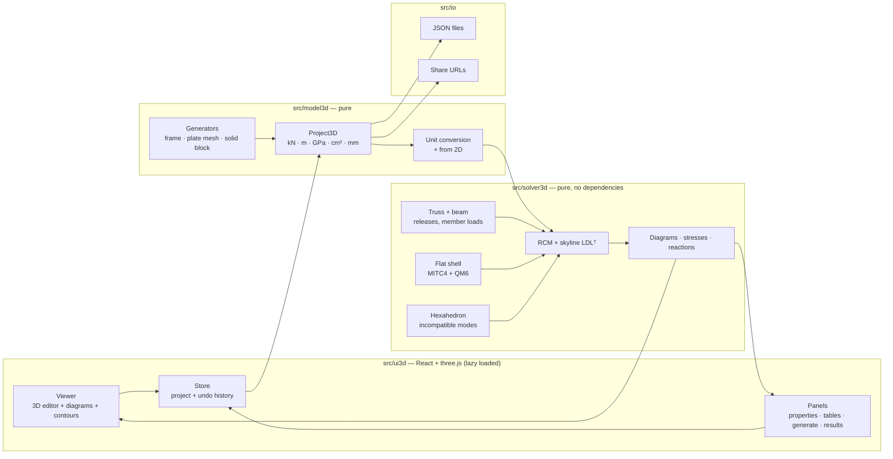

<div align="center">

# FrameForge

**A free, lightweight structural analysis tool that runs entirely in your browser.**

Draw a truss, beam or frame in 2D and get deflections, reactions, force diagrams and
IS 800:2007 steel checks instantly — or switch to the 3D workspace for space frames, space
trusses, plate (shell) meshes and solid blocks. No install, no licence, no backend.

### [▶ Open the live demo](https://wrucebayne29.github.io/frameforge/)

[](https://github.com/WruceBayne29/frameforge/actions/workflows/ci.yml)
[](https://github.com/WruceBayne29/frameforge/actions/workflows/deploy.yml)
[](LICENSE)


</div>

## Why

Commercial packages like STAAD.Pro and SAP2000 are powerful, expensive and heavy. As a civil
engineering student you mostly need to check a homework frame, see what a hinge does to a bending
moment diagram, or find out why your truss is a mechanism. FrameForge does exactly that, in a
browser tab, with a solver you can read.

The 2D solver is written from scratch in TypeScript using the **direct stiffness method** — no FEM
libraries — and is checked against 26 textbook problems to within 0.1 %. The 3D solver (truss,
beam, flat-shell and hexahedral solid elements) is written the same way and is checked against
20 more problems: closed-form answers for space trusses and frames, and published plate, shell
and elasticity benchmarks for the finite elements.

## Features

The app has two workspaces, switched with the **2D | 3D** buttons in the top bar. Each keeps its
own model. The 2D workspace is described first; the 3D one has
[its own section below](#3d-space-structures).

**2D analysis**

- 2D frame (axial + shear + bending) and pin-ended truss elements
- Fixed, pinned and roller supports; member end releases (internal hinges)
- Point loads, moments, uniform and trapezoidal loads over all or part of a member, in local or
  global axes
- Nodal displacements, support reactions, member end forces
- Exact axial force, shear force and bending moment diagrams, with maxima located at points of
  zero shear, and the exact deflected shape along every member
- Unstable structures are caught and explained ("mechanism detected at node N4, vertical
  translation") instead of returning garbage

**Editor**

- Click to add nodes, members, supports and loads, with snap-to-grid
- Click a member to split it — its loads are carried over to both halves
- Drag a node and watch the results update live
- Undo / redo for everything, including loading a new model
- Edit-by-table for nodes, members and loads as an alternative to drawing

**Results**

- Deflected shape and diagrams with scale sliders
- Reaction arrows with values
- Hover anywhere on a member for N, V, M and deflection at that point
- Results, displacement and member force tables

**Steel design — IS 800:2007**

- Built-in table of 25 rolled sections (ISMB 100–600, ISMC 75–400)
- Section classification, tension, compression buckling, bending with lateral-torsional
  buckling, shear and combined axial + bending interaction
- Utilisation ratio shown as a colour on every member, with the full check breakdown per member

**Beyond statics**

- Modal analysis: natural frequencies and animated mode shapes from consistent mass matrices
- Influence lines for reactions, shear, bending moment and deflection under a moving unit load

**Sharing**

- PDF calculation report: inputs, results, diagrams and design checks, drawn as vectors
- Save and open models as JSON
- Shareable links — the whole model is compressed into the URL, nothing is uploaded
- Your last model is restored when you come back

**Polish**

- Dark and light themes, responsive layout down to phone width
- Keyboard shortcuts for every tool and view
- First-run walkthrough
- Nine example structures, including a 32.5 m transmission tower

**3D workspace** (details in [3D space structures](#3d-space-structures))

- Truss (6 DOF), beam (12 DOF), 4-node plate and 8-node solid elements in one model
- Nodal loads, member UDLs / trapezoidal / point loads and moments, plate pressures and point
  loads, solid face loads, self-weight
- Six force diagrams per member, contour plots on plates and solids, reactions, result tables
- Three.js editor with drawing tools, generators for frames, plate meshes and solid blocks, nine
  examples, files and share links

## Screenshots (2D)

| Design checks on a multi-storey frame | Transmission tower, coloured by utilisation |
| --- | --- |
|  |  |

| Axial forces in a Pratt truss | Edit by table |
| --- | --- |
|  |  |

| Animated mode shapes | Influence lines |
| --- | --- |
|  |  |

| PDF calculation report | Phone layout |
| --- | --- |
|  |  |

## 3D space structures

The 3D workspace analyses any linear elastic structure built from four element types that share
the same nodes. Global axes are right-handed with **Y up**; every node has six degrees of
freedom $[u_x, u_y, u_z, \theta_x, \theta_y, \theta_z]$. The workspace (three.js and the 3D
solver) is loaded only when you switch to it, so the 2D first load is unchanged.

| Element | Nodes | DOF | Formulation | Results |
| --- | --- | ---: | --- | --- |
| Truss | 2 | 6 | Axial bar, 3 translations per node | N, elongation |
| Beam | 2 | 12 | Euler–Bernoulli, axial + biaxial bending + St Venant torsion; roll angle β; any of the six end forces released at either end (static condensation) | N, Vy, Vz, T, My, Mz along the member, exact deflected shape |
| Plate | 4 | 24 | Flat shell: MITC4 Mindlin bending + QM6 incompatible-mode membrane + drilling penalty | Nx, Ny, Nxy, Mx, My, Mxy, Qx, Qy, top / bottom surface stresses, principal and von Mises |
| Solid | 8 | 24 | Hexahedron with Wilson–Taylor incompatible modes (modified, passes the patch test) | Stress tensor, principal and von Mises stresses at the centre and nodes |

**Loads.** Point loads (forces and moments) on nodes; uniform and trapezoidal distributed loads
over all or part of a member, point loads and point moments anywhere on a member, in local or
global axes; uniform pressure on plates (along the plate normal or a global axis) and point loads
anywhere on a plate; uniform pressure or traction on any face of a solid; self-weight of every
element from its material density. One load can act on many members, plates or solids at once.

**Supports.** Any combination of the six restraints at a node. The solver also accepts support
settlements and spring supports, but the 3D editor does not expose them yet.

**Results.** Deformed shape with a scale slider; N, Vy, Vz, T, My and Mz diagrams; reaction
arrows; contour plots of displacement, plate von Mises (top / bottom), Mx, My, Mxy and solid von
Mises and principal stresses; tables of displacements, reactions, member end forces and extremes,
plate and solid stresses; an equilibrium check (sum of loads and reactions). A mechanism that the
loads do not excite (a beam on two pins spinning about its own axis) is held automatically and
reported; one they do excite is an error that names the node and direction.

**Editor.** Orbit, pan and zoom with Iso / Top / Front / Side views; tools to add nodes, members,
plates, supports and loads, select and edit in a properties panel or by table; generators for a
multi-storey building frame, a plate mesh on any four corners and a solid block; materials,
rolled ISMB / ISMC sections and custom sections; undo / redo; save and open JSON, share links,
PNG export. "Open in 3D" in the 2D workspace converts a plane model into the z = 0 plane.

**Examples.** Building frame, braced frame, portals with a pinned secondary beam, 25-bar
transmission tower, double-layer space-truss roof, simply supported slab, solid cantilever, slab
on beams and columns, pad footing under a column.

**Solver.** The equations are numbered in reverse Cuthill–McKee order and solved by a skyline
(profile) $LDL^T$ factorisation, so memory grows with the profile rather than $n^2$. A 30 × 30
plate mesh (≈ 5,600 equations) solves in about half a second in the browser. The theory is in
**[docs/THEORY_3D.md](docs/THEORY_3D.md)**.

| Three-storey frame, Mz diagrams and reactions | Slab on beams: plate stress contours and beam moments |
| --- | --- |
|  |  |

| 25-bar transmission tower, axial forces | Pad footing of 8-node solids (dark theme) |
| --- | --- |
|  |  |

**Limitations of the 3D workspace**

- One load case; no load combinations.
- No PDF report, no IS 800 design check, no modal analysis and no influence lines in 3D (all
  four are 2D only).
- The solve runs on the main thread: about 0.5 s for ≈ 5,600 equations, so very large meshes
  make editing sluggish.
- The torsion constant of rolled ISMB / ISMC sections comes from the thin-walled formula
  $\sum b t^3 / 3$ (fillets ignored), which is slightly below handbook values.
- A warped quadrilateral plate is analysed on its projection onto the mean plane (a warning is
  shown); plate loads produce nodal forces only.
- Plate and solid stresses are element values at the nodes, not averaged between elements
  (contour plots average them for display).
- Solids can only be created with the block generator; there is no drawing tool for them.
- Labels are drawn on top of everything, so labels behind a solid are not hidden.
- Linear elastic, small displacements; no P-Δ, buckling, cracking or yielding.

## Quick start

```bash
git clone https://github.com/WruceBayne29/frameforge.git
cd frameforge
npm install
npm run dev
```

| Command | What it does |
| --- | --- |
| `npm run dev` | Start the app with hot reload |
| `npm test` | Unit tests and the validation suite |
| `npm run coverage` | Tests with coverage (thresholds enforced on the solver) |
| `npm run check` | Lint + tests + production build — run before every commit |
| `npm run validation` | Regenerate `VALIDATION.md` from the 2D test suite |
| `npm run validation3d` | Regenerate `VALIDATION_3D.md` from the 3D test suite |
| `npm run e2e` | Playwright script that clicks through every feature on the live site |
| `npm run e2e3d` | Playwright script that exercises the 3D workspace (examples, tools, generators, results, files, layouts) |
| `npm run screenshots` | Regenerate the screenshots and GIF in this README |

## How it works

A structure is a set of members joined at nodes. Each node can move in x, move in y and rotate,
so a structure with $n$ nodes has $3n$ degrees of freedom. The direct stiffness method builds one
big system of equations

$$ K\,u = F $$

where $u$ holds every nodal displacement, $F$ every nodal load, and $K$ is the **global stiffness
matrix**, assembled from the small stiffness matrix of each member.

**1. Element stiffness.** In its own (local) axes, a frame member of length $L$ with axial
stiffness $EA$ and bending stiffness $EI$ relates its six end displacements to its six end forces
through

$$
k_l =
\begin{bmatrix}
\frac{EA}{L} & 0 & 0 & -\frac{EA}{L} & 0 & 0 \\
0 & \frac{12EI}{L^3} & \frac{6EI}{L^2} & 0 & -\frac{12EI}{L^3} & \frac{6EI}{L^2} \\
0 & \frac{6EI}{L^2} & \frac{4EI}{L} & 0 & -\frac{6EI}{L^2} & \frac{2EI}{L} \\
-\frac{EA}{L} & 0 & 0 & \frac{EA}{L} & 0 & 0 \\
0 & -\frac{12EI}{L^3} & -\frac{6EI}{L^2} & 0 & \frac{12EI}{L^3} & -\frac{6EI}{L^2} \\
0 & \frac{6EI}{L^2} & \frac{2EI}{L} & 0 & -\frac{6EI}{L^2} & \frac{4EI}{L}
\end{bmatrix}
$$

A truss member keeps only the $EA/L$ terms.

**2. Rotate to global axes.** For a member inclined at $\theta$, with $c = \cos\theta$ and
$s = \sin\theta$,

$$
k_g = T^{T} k_l\, T, \qquad
T = \begin{bmatrix} R & 0 \\ 0 & R \end{bmatrix}, \qquad
R = \begin{bmatrix} c & s & 0 \\ -s & c & 0 \\ 0 & 0 & 1 \end{bmatrix}
$$

**3. Assemble and apply supports.** Each $k_g$ is added into $K$ at the rows and columns of its
two nodes. Splitting the degrees of freedom into free ($f$) and restrained ($r$) gives

$$ K_{ff}\,u_f = F_f - K_{fr}\,u_r, \qquad R = K_{rf}\,u_f + K_{rr}\,u_r - F_r $$

$K_{ff}$ is symmetric positive definite for a stable structure, so it is solved by Cholesky
factorisation. A zero pivot means a mechanism, and its position says which node is free to move.

**4. Member loads.** A distributed load $w(x)$ is replaced by work-equivalent nodal loads using
the member's shape functions $N(x)$:

$$ f_{eq} = \int_0^L N^{T}(x)\,w(x)\,dx $$

For a uniform load this gives the familiar $wL/2$ and $wL^2/12$. The integral is evaluated with
Gauss quadrature, which is exact for the partial and trapezoidal loads FrameForge supports.

**5. Hinges.** A moment release is handled by statically condensing the released rotation out of
the element matrices, which turns the $4EI/L$ terms into $3EI/L$:

$$ k^{\ast} = k_{kk} - k_{kr}\,k_{rr}^{-1}\,k_{rk} $$

**6. Recover the diagrams.** Member end forces are $f = k_l\,u_l - f_{eq}$. From those, $N(x)$,
$V(x)$ and $M(x)$ follow from statics, and the deflected shape from integrating
$EI\,v'' = M$ twice.

The full derivation — shape functions, the stiffness integral, a worked example, the IS 800
formulas — is in **[docs/THEORY.md](docs/THEORY.md)**.

**In 3D** the same steps apply with six DOFs per node: a 12 × 12 beam matrix rotated by a 3 × 3
direction-cosine block, a 24 × 24 flat-shell matrix and a 24 × 24 hexahedron matrix, assembled
into a sparse matrix and solved by a skyline $LDL^T$ factorisation. The derivations are in
**[docs/THEORY_3D.md](docs/THEORY_3D.md)**.

## Validation

Every solver change is checked against closed-form textbook answers. The tables below are
generated by the test suites themselves (`npm run validation`, `npm run validation3d`); the
complete results, quantity by quantity, are in **[VALIDATION.md](VALIDATION.md)** and
**[VALIDATION_3D.md](VALIDATION_3D.md)**.

### 2D

<!-- validation:start -->
**26 problems, 122 quantities, all within 0.1 %.**

| # | Problem | Closed-form checks | Quantities | Max error |
| --- | --- | --- | ---: | ---: |
| V01 | Cantilever with a point load at the tip | PL³/3EI, PL²/2EI, PL (hogging), … | 5 | < 0.0001 % |
| V02 | Cantilever with a uniformly distributed load | wL⁴/8EI, wL³/6EI, wL²/2 (hogging), … | 5 | < 0.0001 % |
| V03 | Simply supported beam with a central point load | PL³/48EI, PL/4, PL²/16EI, … | 5 | < 0.0001 % |
| V04 | Simply supported beam with a UDL (single element) | 5wL⁴/384EI, wL²/8, wL³/24EI, … | 5 | < 0.0001 % |
| V05 | Simply supported beam with an off-centre point load (member load) | Pb/L, Pa/L, Pab/L, … | 5 | < 0.0001 % |
| V06 | Propped cantilever with a UDL | 3wL/8, 5wL/8, wL²/8 (hogging), … | 6 | < 0.0001 % |
| V07 | Fixed-fixed beam with a UDL | wL²/12 (hogging), wL²/24, wL⁴/384EI, … | 4 | < 0.0001 % |
| V08 | Fixed-fixed beam with a central point load | PL/8 (hogging), PL/8, PL³/192EI | 3 | < 0.0001 % |
| V09 | Two-span continuous beam, equal spans, UDL | 3wL/8, 10wL/8, wL²/8 (hogging), … | 5 | < 0.0001 % |
| V10 | Three-span continuous beam, equal spans, UDL | 0.4wL, 1.1wL, 0.1wL² (hogging), … | 5 | < 0.0001 % |
| V11 | Fixed-base portal frame with a lateral load | Ph(3k+1)/[2(6k+1)], 3Phk/[2(6k+1)], P/2, … | 5 | < 0.0001 % |
| V12 | Pinned-base portal frame with a UDL on the beam | wL²/[4h(2k+3)], H·h (hogging), wL²/8 − H·h, … | 4 | < 0.0001 % |
| V13 | Pratt truss, 4 panels, loads at the bottom-chord joints | −1.5P/sinθ, 1.5Pa/h, −2Pa/h, … | 7 | < 0.0001 % |
| V14 | Warren truss (equilateral), loads at the bottom-chord joints | −2P/√3, 2P/√3, 0 (zero shear panel), … | 7 | < 0.0001 % |
| V15 | Symmetric two-bar truss | −P/(2 sinθ), PL/(2EA sin²θ), P/(2 tanθ) | 3 | < 0.0001 % |
| V16 | Compound beam with an internal hinge (member end release) | wL₂/2, 0, (wL₂/2)·L₁ (hogging), … | 5 | < 0.0001 % |
| V17 | Fixed-fixed beam with a support settlement | 6EIΔ/L², 12EIΔ/L³, 6EIΔ/L² | 3 | < 0.0001 % |
| V18 | Simply supported beam with a triangular load | wL/6, wL/3, wL²/(9√3), … | 5 | < 0.0001 % |
| V19 | Fixed-fixed beam with a triangular load | wL²/30, wL²/20, 3wL/20, … | 4 | < 0.0001 % |
| V20 | Simply supported beam with a counter-clockwise moment at midspan | M₀/L, −M₀/L, M₀/2, … | 5 | < 0.0001 % |
| V21 | Inclined simply supported rafter under gravity load | wL/2, w·L·L_h/8, −(wL/2)·sinα, … | 4 | < 0.0001 % |
| V22 | Cantilever propped by a spring | P/(k_s + 3EI/L³), P·k_s/(k_s + 3EI/L³), (P − F_s)·L (hogging) | 3 | < 0.0001 % |
| V23 | Natural frequencies of a simply supported beam (modal analysis) | π²·√(EI/mL⁴), 4π²·√(EI/mL⁴), 9π²·√(EI/mL⁴), … | 4 | 0.0260 % |
| V24 | Natural frequencies of a cantilever (modal analysis) | 1.8751²·√(EI/mL⁴), 4.6941²·√(EI/mL⁴), 2π/ω₁ | 3 | 0.0016 % |
| V25 | Influence lines for a simply supported beam | 1 − x/L, 1 − x/L, L/4, … | 6 | < 0.0001 % |
| V26 | Influence line for the central reaction of a two-span continuous beam | x(3L² − x²)/2L³, x(3L² − x²)/2L³, x(3L² − x²)/2L³, … | 6 | < 0.0001 % |
<!-- validation:end -->

### 3D

Line elements are exact for the loads they carry, so truss and beam cases must match to 0.1 %.
Plate and solid cases compare a finite-element mesh with a continuum solution; each states the
tolerance its mesh is expected to meet, and the table shows the error actually reached.

<!-- validation3d:start -->
**27 problems, 125 quantities, each within its stated tolerance.**

| # | Problem | Quantities | Tolerance | Max error |
| --- | --- | ---: | ---: | ---: |
| T01 | Tripod (statically determinate space truss) under a general apex load | 7 | 0.1 % | < 0.0001 % |
| T02 | Square pyramid (one redundant bar) under vertical and horizontal apex loads | 5 | 0.1 % | < 0.0001 % |
| B01 | L-shaped cantilever (grillage) with an out-of-plane tip load: bending + torsion | 8 | 0.1 % | < 0.0001 % |
| B02 | Skew cantilever, roll angle β = 30°, with a biaxial tip load | 8 | 0.1 % | < 0.0001 % |
| B03 | Fixed-fixed beam along Z: UDL in the local x–y plane, point load in the local x–z plane | 8 | 0.1 % | < 0.0001 % |
| B04 | Four-column table frame swaying in X and Z (weak and strong column axes) | 6 | 0.1 % | < 0.0001 % |
| B05 | Secondary beam with moment releases at both ends, framing into two fixed girders | 7 | 0.1 % | < 0.0001 % |
| B06 | Simply supported beam on a skew plan line (30° to X) with vertical and lateral UDLs | 7 | 0.1 % | < 0.0001 % |
| B07 | Space frame with every member load type: reactions balance the loads (6 components) | 6 | 0.1 % | < 0.0001 % |
| P01 | Simply supported square plate, uniform pressure (a/t = 100, 16 × 16 mesh) | 4 | 1 % | 0.0746 % |
| P02 | Simply supported square plate, central point load (16 × 16 mesh) | 2 | 1 % | 0.3519 % |
| P03 | Clamped square plate, uniform pressure (a/t = 100, 16 × 16 mesh) | 2 | 2 % | 0.4280 % |
| P04 | Cantilever plate strip (ν = 0) with a tip line load, 10 elements | 4 | 0.5 % | 0.2500 % |
| P05 | Square plate twisted by corner forces (pure Mxy), a/t = 100, 4 × 4 mesh | 2 | 0.5 % | 0.0705 % |
| P06 | Scordelis–Lo barrel vault under self-weight (quarter model, 16 × 16 mesh) | 1 | 1 % | 0.0005 % |
| P07 | Square box-section cantilever of folded plates (20 × 8 mesh), end torque | 4 | 0.5 % | 0.1558 % |
| H01 | Prismatic bar in uniaxial tension (4 × 1 × 1 hexahedra) | 6 | 0.1 % | < 0.0001 % |
| H02 | Slender solid cantilever (L/h = 10) with an end shear, 20 × 2 × 2 hexahedra | 3 | 1 % | 0.1524 % |
| H03 | Constant-strain patch test on a distorted 3 × 3 × 3 mesh of a unit cube | 9 | 0.1 % | < 0.0001 % |
| H04 | Solid column under its own weight (ν = 0, 2 × 6 × 2 hexahedra) | 4 | 0.1 % | < 0.0001 % |
| M01 | Natural frequencies of a simply supported beam, bending about both axes (16 elements) | 4 | 0.1 % | 0.0016 % |
| M02 | Cantilever: first two bending frequencies and effective modal mass (12 elements) | 3 | 0.1 % | 0.0378 % |
| M03 | Fixed–free shaft: torsional and axial frequencies (20 elements) | 3 | 0.3 % | 0.2315 % |
| M04 | Simply supported square plate, first two frequencies (a/t = 100, 16 × 16 mesh) | 2 | 2 % | 1.4340 % |
| M05 | Solid cantilever (ν = 0, L/h = 20, 20 × 2 × 2 hexahedra): bending and axial frequencies | 2 | 1.5 % | 0.1141 % |
| I01 | Influence lines of a two-span continuous beam along Z: central reaction and support moment | 4 | 0.1 % | < 0.0001 % |
| I02 | L-shaped grillage: torque and bending at the root as a load moves along the arm | 4 | 0.1 % | < 0.0001 % |
<!-- validation3d:end -->

## Architecture

The solvers know nothing about React, the browser or units. The UIs know nothing about matrices.
The 2D and 3D workspaces are parallel stacks that share the section table, the error type and
the file / share-link machinery.





```
src/
  solver/         2D direct stiffness method, modal analysis, influence lines
  solver3d/       3D truss, beam, plate and solid elements, sparse skyline solver
  design-codes/   IS 800:2007 member checks and the rolled-section table
  model/          the 2D project model, unit conversion and pure editing operations
  model3d/        the 3D project model, generators, conversion from 2D
  examples/       nine ready-made 2D structures
  examples3d/     nine ready-made 3D structures
  io/             JSON files and share links (2D and 3D), PDF report (2D)
  ui/             2D React components: canvas, toolbar, panels
  ui3d/           3D React components and the three.js viewer
tests/validation/ 26 2D problems and 20 3D problems with reference answers
scripts/          Playwright end-to-end scripts (2D, 3D) and screenshot generator
docs/             THEORY.md, THEORY_3D.md and screenshots
```

Engineering rules the code holds itself to: strict TypeScript with no `any`, ESLint and Prettier
clean, coverage thresholds enforced in CI, and lint + tests + build run before every commit.

## Keyboard shortcuts

These are the 2D shortcuts; the 3D workspace lists its own under **Help** (or press `?`).

| Key | Action | Key | Action |
| --- | --- | --- | --- |
| `V` | Select / move | `1` `2` `3` | Axial / shear / moment diagram |
| `N` | Add node | `0` | Hide diagrams |
| `M` | Draw member | `D` | Toggle deflected shape |
| `S` | Add support | `R` | Toggle reactions |
| `L` | Add load | `U` | Toggle utilisation colours |
| `X` | Delete tool | `F` | Fit to window |
| `Del` | Delete selection | `G` | Toggle snap |
| `Ctrl+Z` / `Ctrl+Shift+Z` | Undo / redo | `?` | Help |

## Assumptions and limits

FrameForge does linear elastic, small-displacement analysis. In 2D, modal analysis uses the
members' self-weight as the only mass, and the frame element does not model shear deformation
or out-of-plane behaviour (use the 3D workspace for that). Neither workspace models P-Δ
effects or material yielding; the 3D limitations are listed in
[3D space structures](#3d-space-structures). The design module
checks rolled ISMB and ISMC members for axial force and major-axis bending, uses the analysis loads
as design loads, and applies one steel grade and effective length factor to the whole model.

It is a learning tool. Do not use it as the sole basis for a real design.

## Roadmap

- [x] Direct stiffness solver with validation suite
- [x] Interactive editor, results view, IS 800 checks
- [x] PDF, JSON and share-link export
- [x] Modal analysis (natural frequencies, mode shapes)
- [x] Influence lines for moving loads
- [ ] Load cases and combinations with IS 875 / IS 800 load factors
- [ ] Angle and hollow sections; built-up members
- [ ] Self-weight and temperature loads
- [ ] Inclined supports
- [ ] Second-order (P-Δ) analysis
- [x] 3D space frames, space trusses, plates and solids
- [ ] 3D load combinations, design checks and PDF report
- [ ] IS 456 reinforced concrete beam checks

## Contributing

Bug reports and pull requests are welcome — see [CONTRIBUTING.md](CONTRIBUTING.md). If the solver
gives you a wrong answer, please open a "wrong result" issue with the share link and the expected
value; that is the most useful kind of bug report there is.

## License

[MIT](LICENSE)
